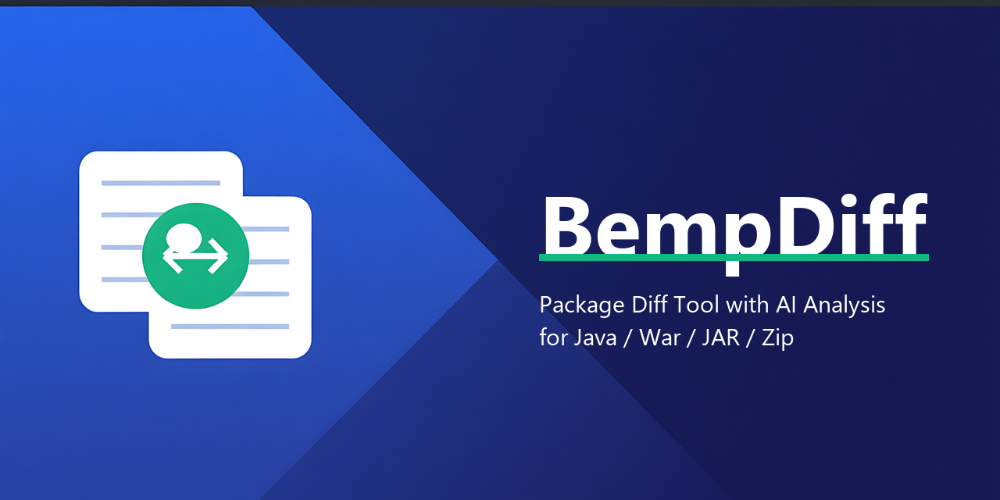

# BempDiff

[](LICENSE)
[](https://github.com/wangnan05563/bempDiff/releases/latest)
[](https://github.com/wangnan05563/bempDiff/releases)



A desktop **package diff & AI analysis** tool for Java delivery artifacts: **war / jar / zip / folders**. Drop in two builds, get a tree-structured diff, decompiled source-level changes, and AI-powered risk analysis — all without installing Java separately.

> **Why BempDiff?** Production-vs-release package comparison is still mostly manual. BempDiff turns it into a repeatable workflow: recursive unpacking, layered structured diffing, CFR decompilation, AST-aware normalization, and optional LLM analysis with cost gating and desensitization — plus a headless `ci` entry point that can gate a pipeline by exit code.

Chinese feature walkthrough: [`bempdiff/README.md`](bempdiff/README.md).

---

## Highlights

### Diff engine
- **Layered diff view**: `L0` package manifest → `L1` internal business classes → `L2` third-party jars. Noise is folded by default.
- **Recursive unpacking**: nested `war → jar → zip` unpacked to atomic entries. Entries under 64 KB stay in memory; each compare job gets a 256 MB in-memory budget with a 3× global hard cap, and anything above falls back to disk.
- **Source-level decompilation**: CFR primary, `javap` fallback, GBK-tolerant decoding, changed lines + line ranges only.
- **AST-aware normalization** (FR-006): decompiled sources are re-parsed through the JDK `com.sun.source` (javac) API, so reordering and re-formatting collapse to zero false diffs; unparsable files degrade to line diff.
- **API compatibility grading** (FR-007): added / removed / signature-changed / behaviour-changed classification, exported into the report and the CI JSON.
- **Beyond packages**: JS / HTML / CSS text diff with pretty-print normalization, folder-vs-folder comparison (name / type / size / mtime / SHA-256), archive manifest diff (zip/war/ear), Office document text diff (docx/xlsx/pptx).
- **Ignore rules** (FR-008): whitespace / comment / custom-regex normalization on the engine side, plus client-side path, prefix, name and extension ignore rules managed from the tree context menu.

### Review UX
- **BCompare-style shell**: tree view with collapse / expand all, path history (back / forward / up), drag-to-compare, unified file/directory browse dialog.
- **Character-level inline highlighting** (FR-002) and **collapse-unchanged regions** (FR-003, configurable context window, plus a diff-only view).
- **Themes** (FR-004 / FR-014): light / dark / follow-system, several accent palettes, and switchable syntax-highlight theme packs.
- **Bilingual UI**: Simplified Chinese and English, switchable at runtime.
- **Gutter actions** (FR-015): copy line to the other side, mark-as-reviewed, keyboard navigation between hunks.
- **Compare sessions** (FR-010): recent comparisons are recorded and replayable; exports are handled by a download manager for large packages.

### AI analysis
- **Two-stage pipeline** (FR-012): whole-package risk overview + top-K per-file deep read, backed by an impact analysis over the decompiled call relations.
- **Cost transparency** (FR-013): token/cost estimate before the call, actual input/output usage after, with a configurable gate that blocks oversized requests.
- **Project-context enhancement**: an offline scan of a source project (build system, modules, conventions) is injected into the prompt so conclusions match the real codebase.
- **Graceful degradation**: an unreachable provider downgrades to a mock path instead of failing the comparison; `--apikey ""` forces the local mock.

### Reports & packaging
- **Export suite** (FR-009 / FR-011): Markdown report, self-contained HTML report (inline CSS, print friendly), CI JSON summary, changed-class asset zip, decompiled source bundle, desensitized diagnostic bundle.
- **Cross-platform installers** via electron-builder with a trimmed JRE bundled — Windows x64/arm64 (NSIS), Linux arm64 (AppImage + deb), macOS arm64 (dmg, unsigned).

---

## Tech Stack

| Layer | Technology |
|---|---|
| Desktop shell | Electron 31 |
| Frontend | Vue 3 + Bootstrap 5 + Vite 5, Vitest for unit tests |
| Diff engine / AI sidecar | Java 21, embedded HTTP server on `127.0.0.1:18765` |
| Decompilation | CFR (primary) + `javap` (fallback) |
| Syntax normalization | JDK `com.sun.source` javac AST API (no extra native dependency) |
| Archive / Office reading | JDK `java.util.zip` + Apache POI |
| AI provider | OpenAI-compatible APIs (OpenAI, Azure, Ollama, Tongyi, …) |
| Packaging / CI | electron-builder (NSIS / AppImage / deb / dmg), GitHub Actions (incl. ARM runners), SonarQube + JaCoCo |

---

## Installation

Grab the installer from [Releases](https://github.com/wangnan05563/bempDiff/releases).

| Platform | Artifact | Status |
|---|---|---|
| Windows x64 | `BempDiff-<version>-setup.exe` | published on every release |
| Windows arm64 | `BempDiff-<version>-arm64-setup.exe` | built by [`build-arm64.yml`](.github/workflows/build-arm64.yml) (`workflow_dispatch`) |
| Linux arm64 | `BempDiff-<version>-arm64.AppImage` / `.deb` | built by [`build-arm64-unix.yml`](.github/workflows/build-arm64-unix.yml) (`workflow_dispatch`) |
| macOS arm64 | `BempDiff-<version>-arm64.dmg` | built by the same workflow, **unsigned** — right-click → Open the first run |

Every installer embeds a trimmed JRE, so no separate Java installation is needed. Build details: [`docs/构建手册-环境补齐与EXE打包.md`](docs/构建手册-环境补齐与EXE打包.md).

---

## Quick Start

### GUI

1. Launch BempDiff.
2. Browse or drag the **old build** (production) and **new build** (release candidate) into the inputs — files and directories share one dialog and are auto-detected.
3. Click **Start Compare** and watch the unpacking progress.
4. Select a changed item in the left tree to see the two-pane source diff (full / diff-only, unified / split / wrap).
5. Optionally open **Settings → AI**, enter a provider Base URL + API Key, then run **Smart Analysis** for the risk overview and per-file deep read.
6. Use the **Export** menu for Markdown / HTML reports, asset zips and the diagnostic bundle.

### CLI / CI

With a subcommand, the executable runs headless and exits — the same engine, no window:

```text
inspect         <pkg>
compare         <old> <new> [--expand-all]
compare-folders <leftDir> <rightDir>                                  (folder diff, basic)
folderdiff      <leftDir> <rightDir> [--report <md>] [--max-depth N]
decompile       <old> <new> [--expand-all] [--top-k N] [--cfr <cfr.jar>]
report          <old> <new> [--expand-all] [--top-k N] [--cfr <jar>] [--out <md>]
                             [--ai] [--apikey K] [--baseurl U] [--provider P] [--model M]
                             [--aiconfig <path>] [--project <dir>] [--replay <dir>]
export          <old> <new> [--expand-all] [--top-k N] [--cfr <jar>] [--out <dir>]
diff-jars       <old.jar> <new.jar> [--out <md>]                       (changed lib jars, class level)
ai              <old> <new> [--expand-all] [--top-k N] [--replay <dir>] [--apikey K] [--baseurl U]
server          [--port 18765] [--webroot <dir>]                       (Web UI + REST backend)
ci              --left <old> --right <new> [--report <md>] [--json <out.json>]
                [--fail-on-diff] [--ai] [--top-k N] [--cfr <jar>] [--expand-all]
```

`ci` (FR-005) is the pipeline gate: it reuses the full report path, writes a machine-readable JSON summary, and encodes the verdict in the exit code — `0` no difference, `1` differences found (only with `--fail-on-diff`), `2` usage or runtime error.

```yaml
- name: Compare release candidate against production
  run: BempDiff.exe ci --left prod.war --right rc.war --json ci.json --report ci.md --fail-on-diff
```

The Java sidecar can also be invoked directly:

```bash
java -cp dist_input/classes com.bempdiff.Main <subcommand> ...
```

---

## Configuration

Server-side settings persist to `~/.bempdiff/bempdiff-web.properties` and are editable from **Settings** in the app:

- **Compare**: internal package prefixes (the L1 expansion rule), top-K, ignore whitespace / comments / regex / extensions, nested unpack depth and threads.
- **AI**: provider, Base URL, model, API Key (masked, not persisted unless you opt in), proxy, cost-gate threshold, max input/output tokens, connection test.
- **UI**: theme (light / dark / system), accent palette, diff-tree filters, language, splash screen.
- **Updates**: *About → Check update* reads the latest GitHub Release from `wangnan05563/bempDiff` (override with `BEMPDIFF_GITHUB_REPO`, optional `GITHUB_TOKEN` for private repos or rate limits) — see [`docs/GitHub更新-人工操作手册.md`](docs/GitHub更新-人工操作手册.md).

Client-side preferences (ignore rules, language, reviewed marks) live in browser `localStorage` and never leave the machine.

---

## Architecture

```text
┌──────────────────────────────────────────────────────────┐
│  Electron shell            bempdiff/dev-shell/           │
│  └── Vue 3 SPA             bempdiff/webui/               │
│      diff tree · diff view · AI console · reports        │
├──────────────────────────────────────────────────────────┤
│  Java 21 sidecar           bempdiff/java_core/           │
│  parse/ unpack/  →  diff/ (engine, AST, api-compat)      │
│  decompile/ (CFR + javap)  ·  ai/ (2-stage + context)    │
│  report/ export/ · server/ (BempServer, HTTP + REST)     │
└──────────────────────────────────────────────────────────┘
```

The sidecar listens on `127.0.0.1:18765` and serves both the built SPA and the REST API used by the shell:

`/api/session/compare` · `/api/entry` · `/api/file` · `/api/job` · `/api/export` · `/api/config` · `/api/ai/context` · `/api/ai/models` · `/api/ai/test` · `/api/tasks/running` · `/api/update/check` · `/api/admin/diag-bundle` · `/api/admin/cleanup`

Design documents (interfaces, layering, UX benchmark, performance reports) live in [`docs/`](docs/).

---

## Development

```bash
# Frontend (Vite dev server + Vitest)
cd bempdiff/webui
npm install
npm run dev            # vite dev server
npm run test:unit      # vitest run
npm run build          # production bundle → dist/

# Desktop shell (dev launcher: Java sidecar + Electron window)
tooling/scripts/启动服务.bat      # stop with tooling/scripts/停止服务.bat

# Installer build (compiles Java, fetches trimmed JRE, builds SPA, runs electron-builder)
tooling/scripts/构建打包.bat

# One-click build + GitHub Release publish (set GH_DRY_RUN=1 to simulate)
tooling/scripts/一键发布.bat
```

Useful npm scripts in `bempdiff/package.json`: `dist`, `dist:x64`, `dist:arm64`, `jre:fetch`, `jre:status`.

Java tests run through the lightweight in-repo harness and need `cfr.jar` on the classpath:

```bash
javac -cp "dist_input/classes;toolchain/lib/*" -d out_test test/...
java  -cp "out_test;toolchain/lib/*;dist_input/classes;cfr.jar" \
      com.bempdiff.test.TestRunner com.bempdiff.test.XxxTest
```

Static analysis is configured in [`sonar-project.properties`](sonar-project.properties) (project key `bempdiff`, JaCoCo XML from `tooling/quality/jacoco/`).

### Release convention

Versions are `0.1.<yyyyMMdd><seq>` (the date plus a daily sequence) and are bumped by the build script; the GitHub Release tag is the bare version, which is also what *Check update* compares against.

---

## Security & Privacy

- **API Key** is not persisted to disk by default; it stays in process memory unless you explicitly opt in.
- **AI analysis** applies desensitization rules for financial and personal data before anything leaves the machine, and the cost gate blocks requests above the configured threshold.
- **Local by design**: unpacking, diffing and decompilation never touch the network. The only outbound calls are the AI provider you configure and the GitHub release check.
- Use `--apikey ""` to force the mock AI path and keep everything offline.
- Privilege and network isolation notes: [`docs/SECURITY-权限隔离评审.md`](docs/SECURITY-权限隔离评审.md).

---

## Roadmap

Shipped (M1–M3 of the optimization PRD): inline highlighting, collapse-unchanged, tri-state themes, CLI/CI mode, AST-aligned diff, API compatibility grading, configurable ignore rules, HTML/MD/JSON export, session replay, diagnostic bundle, impact analysis, cost transparency, highlight theme packs, gutter actions.

Next candidates (planning pool, see [`docs/PRD-优化需求全景-基于GitHub同款调研.md`](docs/PRD-优化需求全景-基于GitHub同款调研.md)):

1. Extended archive formats — RAR / 7z / ISO and disk images compared without unpacking.
2. Remote comparison sources — Maven Central artifacts, FTP/SFTP/S3.
3. Dependency-tree / POM diff visualization for Maven and Gradle.
4. Virtualized rendering for very large files, plus multi-monitor / HiDPI polish.
5. Decompiler coverage beyond Java (Kotlin via a jadx route) and AI-driven migration advice.

---

## Contributing

Issues and pull requests are welcome.

- Keep commits scoped; do not bundle unrelated work-in-progress into a PR.
- Run `npm run test:unit` for frontend changes and the `TestRunner` harness for `java_core` before pushing.
- Batch scripts must stay pure ASCII (see [`.gitattributes`](.gitattributes)); Chinese `.bat` filenames are intentional, their contents are not.
- Architecture history and long-term notes: [`docs/`](docs/) and `.workbuddy/memory/MEMORY.md`.

---

## License

[MIT](LICENSE)

---

## Acknowledgments

- [CFR](https://www.benf.org/other/cfr/) — Java decompiler
- [Apache POI](https://poi.apache.org/) — Office document text extraction
- [Electron](https://www.electronjs.org/), [Vue 3](https://vuejs.org/), [Bootstrap 5](https://getbootstrap.com/), [Vite](https://vitejs.dev/)
