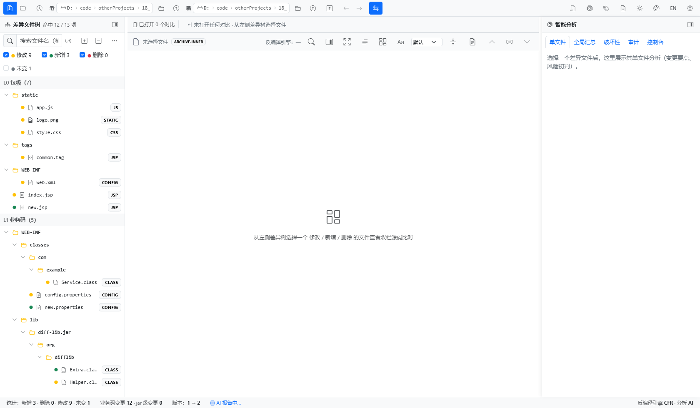
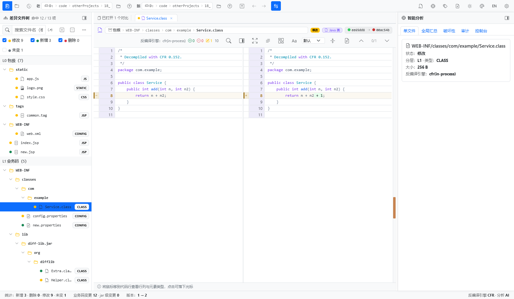
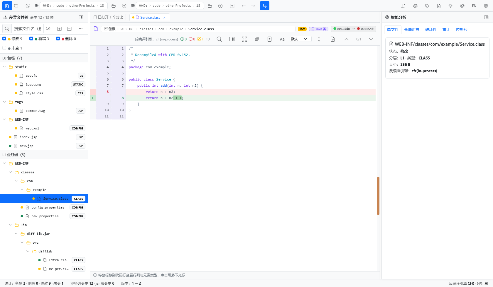
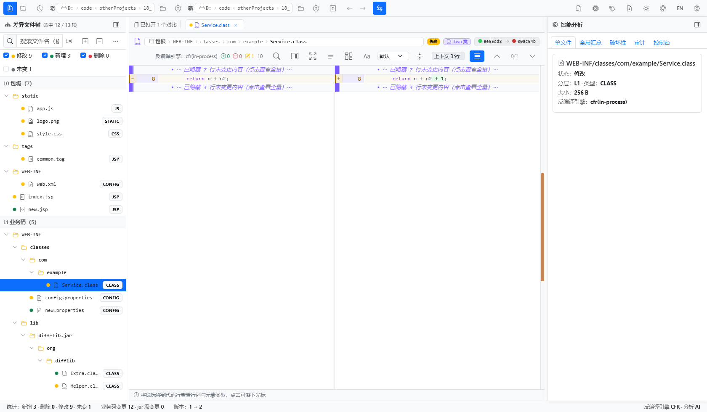
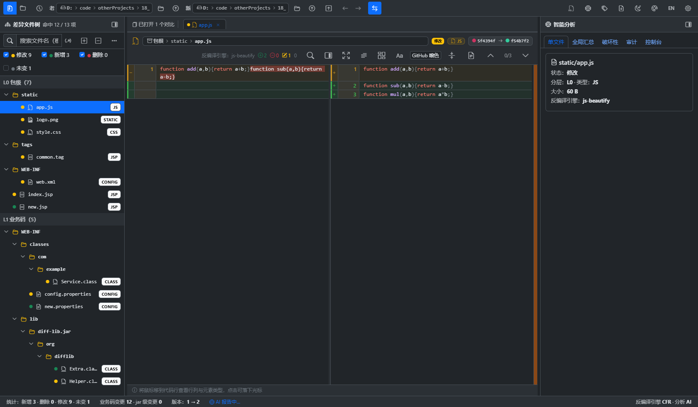
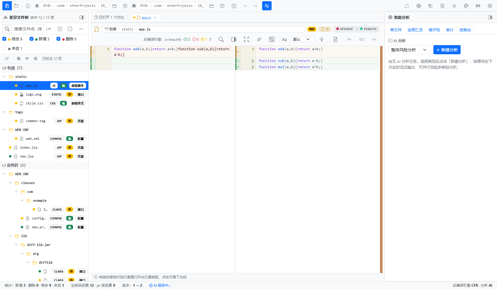
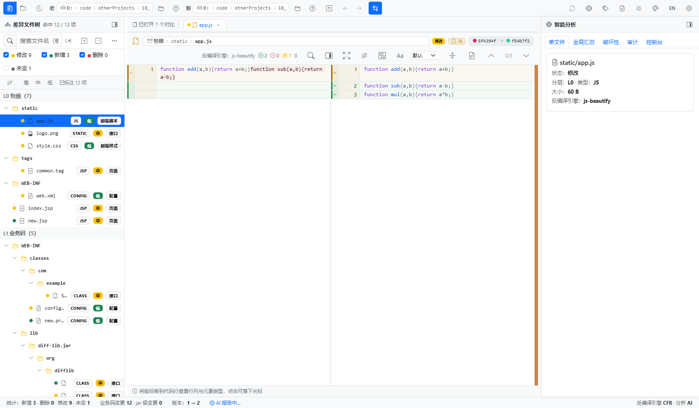
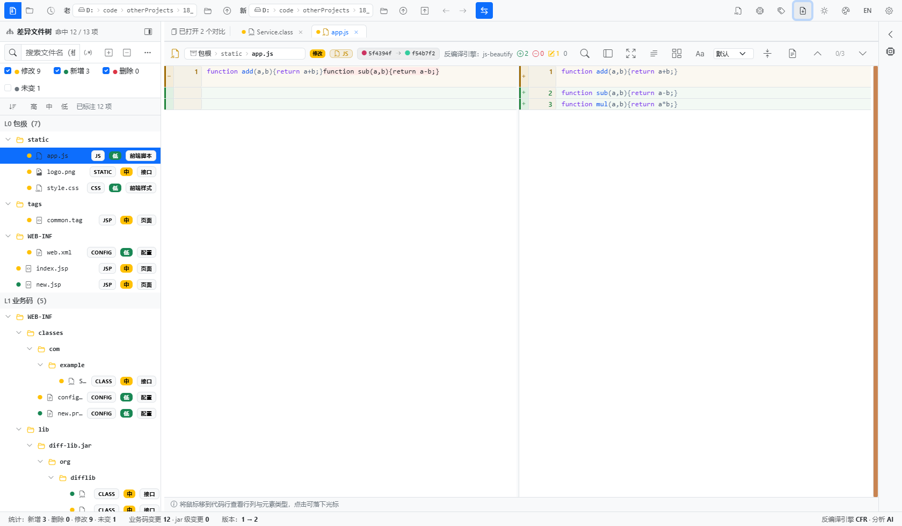
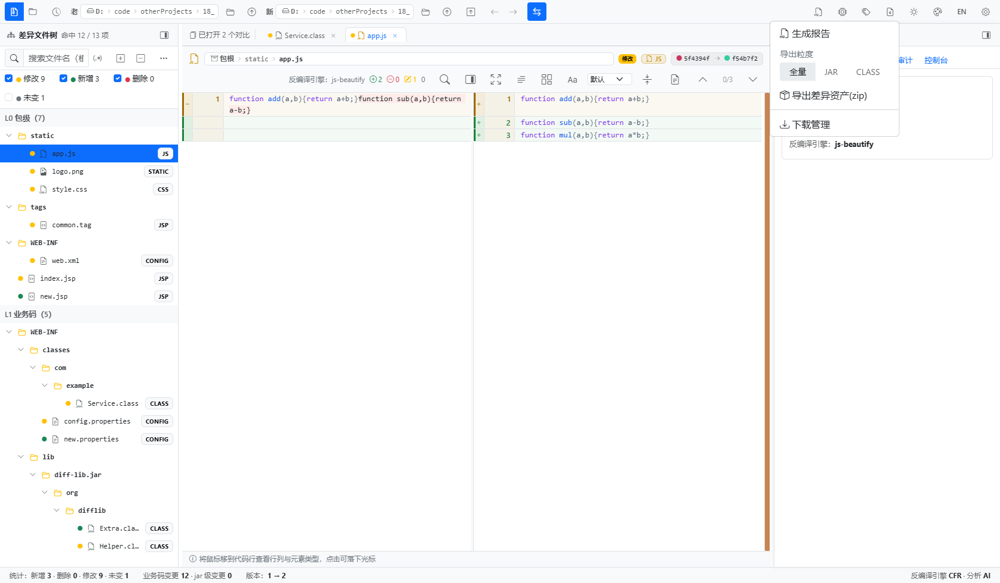

# BempDiff

[](LICENSE)
[](https://github.com/wangnan05563/bempDiff/releases/latest)
[](https://github.com/wangnan05563/bempDiff/releases)


> *Package diff & AI analysis for Java delivery artifacts.*

面向 Java 交付物（**war / jar / zip / 文件夹**）的桌面**差异化对比与智能分析**工具：把两个构建版本丢进来，得到目录树结构的差异、反编译后的源码级改动，以及 AI 风险分析——全程无需另装 Java。

> **为什么做 BempDiff？** 「生产版本 vs 下发版本」的发布前比对至今仍靠人工。BempDiff 把它变成可复用的流程：递归解包 → 分层结构化差异 → CFR 反编译 → AST 归一化 → 可选大模型分析（带成本闸门与脱敏），并提供可用退出码卡住流水线的 `ci` 入口。

模块级中文说明（特性清单、目录结构、开发上手）见 [`bempdiff/README.md`](bempdiff/README.md)。

---

## 它解决什么问题

交付物比对长期依赖「人工解压 + 肉眼比目录 + 记事本看 diff」，既慢又容易漏。尤其是嵌套 jar、混淆前的业务类改动、配置文件键值增删这类差异，靠人力在成千上万个条目里定位，一次发布往往要占用测试和开发各半天以上。

BempDiff 把这件事变成一次拖拽：自动逐层解包 → 按业务重要度分层展示差异 → 把 class 反编译成源码逐行比对 → 可选大模型输出风险概览与逐文件解读 → 导出报告与差异资产包。双击安装即用（安装包内嵌精简 JRE，目标机器无需安装 Java），无需搭建任何服务端，也可以完全离线运行；AI 能力按需开启，自带 API Key 即可，AI 不可达时自动降级，比对与反编译功能不受影响。

> **一句话定位**：把「两个包之间到底改了什么、会影响什么」这个问题，从半天缩短到三分钟。

三种用法同源，按需选择形态：**Windows 桌面应用**（NSIS 安装包）· **命令行 headless**（可嵌 CI）· **本地 Web 服务**。

一份可直接用于内部推广的图文介绍（含下列全部截图）见 [`docs/promo/BempDiff-产品介绍.docx`](docs/promo/BempDiff-产品介绍.docx)，由 [`scripts/build_promo_docx.py`](scripts/build_promo_docx.py) 生成。

---

## 核心能力

### 比对内核
- **分层差异视图**：`L0` 包级清单 → `L1` 内部业务类 → `L2` 第三方 jar，噪声默认折叠。树顶部即时给出「修改 / 新增 / 删除 / 未变」计数，支持模糊搜索、正则过滤与一键展开折叠。
- **递归解包**：嵌套 `war → jar → zip` 逐层展开为原子条目，不放过埋在第三层里的一个 properties 键值改动。单条目 ≤64 KB 驻留内存，每个比对作业独享 256 MB 内存预算、全局 3× 硬上限，超额自动落盘。
- **源码级反编译**：CFR 为主、`javap` 降级，GBK 容错解码，只展示变更行 + 行号区间。
- **语法感知归一化**（FR-006）：反编译源码经 JDK 内置 `com.sun.source`（javac）AST 归一化，格式化调整与成员重排不再报成实质变更；解析失败自动降级为行级 diff。
- **API 兼容性分级**（FR-007）：新增 / 移除 / 签名变更 / 行为变更四类，不兼容项醒目标注，并写入报告与 CI JSON。
- **不只看包**：JS / HTML / CSS 这类压缩文本先做美化（js-beautify）再比对，压缩成一行的脚本也能精确到某个函数体；properties / xml / yml 按键值差异呈现，新增与删除一目了然；目录 vs 目录对比（名称 / 类型 / 大小 / mtime / SHA-256）、zip/war/ear 归档清单级直比、docx/xlsx/pptx 走 Apache POI 抽取正文文本对比。
- **忽略规则**（FR-008）：引擎侧忽略空白 / 注释 / 自定义正则，前端侧按精确路径、前缀、文件名、扩展名管理忽略规则（差异树右键即加，本机持久化）。



*差异文件树：分层视图与「修改 / 新增 / 删除 / 未变」即时计数。*


*前端 JS 资源比对：美化后逐函数对比，新增函数清晰可辨。*

### 审阅体验
- **BCompare 风格外壳**：目录树折叠 / 全部展开、路径导航历史（后退 / 前进 / 向上一层）、拖拽即比、文件与目录同一对话框自动识别。
- **字符级行内高亮**（FR-002）与**未变更区折叠**（FR-003，上下文行数可配，另有「仅差异内容」视图）。高亮粒度可在整行 / 词级 / 字符级三档间循环，能精确到「多了一个 `+ 1`」这种改动。
- **溯源信息同屏**：顶部同时给出两侧 CRC 指纹、文件大小与所属分层，避免「看着一样其实不同」。
- **主题**（FR-004 / FR-014）：亮 / 暗 / 跟随系统三态，默认 / GitHub 亮色 / GitHub 暗色 / One Dark 多套主题与强调色，语法高亮主题包可切换，适配长时间审阅与投屏。
- **中英双语界面**，运行时切换。
- **gutter 快捷操作**（FR-015）：复制到对侧、标记已审阅，`j`/`k` 跳下一处 / 上一处差异，`n`/`p` 跳查找结果，`Ctrl+F` 在差异内容内查找。
- **对比会话**（FR-010）：多标签同时打开多组比对，最近比对历史可一键重放路径对；大包导出交给下载管理器异步处理。
- **专注模式**：隐藏左右栏放大比对视野（`Esc` 退出），适合投屏评审。

| 左右分栏（split）：CFR 还原源码，改动行高亮并给出侧边标记 | Git 风格统一对比（unified）：新旧双行号列 + 字符级高亮 + 右侧差异位置热力条 |
|---|---|
|  |  |

| 仅差异内容模式：未变更行折叠，改动块连续呈现 | 暗色主题下的同一份差异：多套主题与强调色可切换 |
|---|---|
|  |  |

### AI 分析
- **两阶段流水线**（FR-012）：整包风险概览 + Top-K 单文件深读，底层基于反编译调用关系做影响面分析。概览流式输出到控制台，可一键复制 Markdown；单文件结论落在右侧「单文件」面板，与源码比对同屏。
- **多任务控制台**：支持并行发起多类别分析（全局汇总 / 破坏性变更 / 影响范围 / 测试要点 / 自定义问题），思考过程可折叠、可中止、可重启，不阻塞界面操作。
- **智能分类打标**：一键对全部变更文件给出「风险等级 + 变更类别」，结果直接反映在左侧差异树的着色与角标上，扫一眼树就知道红色节点要重点看。接入大模型时由模型结合语义判定；未接入时按内置启发式（文件类型与包路径）给出确定性结果——**这一能力在任何环境下都可用，不会因为没有网络或密钥而空着**。
- **成本透明**（FR-013）：调用前预估 token/费用并按阈值拦截，调用后展示输入 / 输出实际消耗。
- **项目级上下文增强**：分析前离线扫描指定工程目录（构建系统、模块依赖、技术约定），结论贴合真实工程。
- **优雅降级**：AI 不可达或未配 Key 时，比对 / 反编译 / 报告全链照常工作，AI 环节走 Mock；`--apikey ""` 可强制本地 Mock。

| AI 分析发起：控制台选择分析类别后一键发起 | 单文件分析面板：状态、分层、类型、大小与所用反编译引擎 |
|---|---|
|  |  |



*「智能分析」一键打标后的差异树：风险等级以颜色区分，支持按高 / 中 / 低与类别过滤。*

### 报告与打包
- **导出套件**（FR-009 / FR-011）：Markdown 报告、自包含 HTML 报告（内联 CSS、打印友好）、CI JSON 摘要、差异 class 资产 zip、反编译源码包、一键脱敏诊断包。导出粒度可选全量 / JAR / CLASS，按需只取业务码。
- **跨平台安装包**：electron-builder 产出 Windows x64/arm64（NSIS）、Linux arm64（AppImage + deb）、macOS arm64（dmg，未签名），内嵌瘦身 JRE。



*导出入口：报告、差异资产与导出粒度（全量 / JAR / CLASS），大包走异步导出与下载管理。*

---

## 典型应用场景

| 场景 | 过去怎么做 | 用 BempDiff 之后 |
|---|---|---|
| 版本发布前评审 | 开发口头描述改动范围，测试凭经验决定回归面 | 直接给出真实差异清单与 AI 风险提示，回归范围有据可依 |
| 外包 / 分支交付验收 | 担心「夹带改动」，只能抽查几个文件 | 全量逐条目比对 + 反编译级 diff，夹带无处可藏 |
| 生产事故回溯 | 两个环境包不同步，靠日志猜是哪次发布引入 | 拉两份包一比即知差异，配合报告留档可追溯 |
| 依赖与合规审计 | 第三方 jar 变更靠人工看版本清单 | L2 依赖按 jar 折叠提示，CRC 变化即暴露，含二进制资源 |
| 流水线发布门禁 | 无自动化手段，或需自建脚本 | `ci` 子命令 + 退出码，零配置接入现有 CI |

---

## 与常见做法的对比

| 维度 | 人工解压比对 | 通用文本 diff 工具 | BempDiff |
|---|---|---|---|
| 嵌套包处理 | 手动反复解压，极易漏层 | 不支持，只能看到二进制乱码 | 自动逐层解包到原子条目 |
| class 差异 | 反编译工具单看，无法对比 | 不支持 | CFR 反编译后双栏逐行比对 |
| 压缩 JS / 资源 | 基本放弃 | 整行差异不可读 | 美化后比对，精确到函数 |
| 差异降噪 | 无 | 全量输出 | L0/L1/L2 分层 + 内部包前缀 + 忽略规则 |
| 风险判断 | 凭经验 | 无 | 两阶段 AI 分析 + 智能分类着色 |
| 交付物 | 口头 / 截图 | 纯文本 diff | Markdown 报告 + 差异资产包 |
| 落地成本 | 低但耗时 | 低 | 双击安装即用，内嵌 JRE，可离线 |

---

## 技术栈

| 层次 | 技术 |
|---|---|
| 桌面壳 | Electron 31 |
| 前端 | Vue 3 + Bootstrap 5 + Vite 5，单测 Vitest |
| 比对引擎 / AI sidecar | Java 21，内嵌 HTTP 服务监听 `127.0.0.1:18765` |
| 反编译 | CFR（主）+ `javap`（降级） |
| 语法归一化 | JDK `com.sun.source` javac AST API（不引入额外原生依赖） |
| 归档 / Office 解析 | JDK `java.util.zip` + Apache POI |
| AI 服务商 | OpenAI 兼容接口（OpenAI、Azure、Ollama、通义等） |
| 打包 / CI | electron-builder（NSIS / AppImage / deb / dmg）、GitHub Actions（含 ARM runner）、SonarQube + JaCoCo |

---

## 安装

到 [Releases](https://github.com/wangnan05563/bempDiff/releases) 下载对应平台安装包。

| 平台 | 产物 | 状态 |
|---|---|---|
| Windows x64 | `BempDiff-<version>-setup.exe` | 每次发布随版本产出 |
| Windows arm64 | `BempDiff-<version>-arm64-setup.exe` | 由 [`build-arm64.yml`](.github/workflows/build-arm64.yml) 按需构建（`workflow_dispatch`） |
| Linux arm64 | `BempDiff-<version>-arm64.AppImage` / `.deb` | 由 [`build-arm64-unix.yml`](.github/workflows/build-arm64-unix.yml) 按需构建（`workflow_dispatch`） |
| macOS arm64 | `BempDiff-<version>-arm64.dmg` | 同一工作流构建，**未签名**——首次打开需右键 → 打开 |

安装包内嵌瘦身 JRE，无需额外安装 Java。桌面安装包面向 Windows 10 / 11；Linux / macOS 可用 `server` 子命令拉起本地 Web 服务，浏览器访问同一套界面。构建细节见 [`docs/构建手册-环境补齐与EXE打包.md`](docs/构建手册-环境补齐与EXE打包.md)。

---

## 快速开始

### GUI

1. 启动 BempDiff。
2. 浏览或拖入**老包（生产）**与**新包（下发候选）**——文件与目录共用一个对话框，类型自动识别。
3. 点击**开始比对**，等待解包与差异树生成。
4. 左侧差异树点选条目 → 中间双栏源码 diff（全量 / 仅差异，unified / split / wrap）。
5. 需要 AI 分析时，打开**设置 → AI** 填服务商 Base URL + API Key，再用工具栏**智能分析**发起概览与逐文件深读。
6. **导出**菜单产出 Markdown / HTML 报告、差异资产包与脱敏诊断包。

> **试用建议**：拿最近一次已发布的两个包做一次历史比对，用你已知的改动清单去校验工具的差异结果——这是评估工具是否可信最快的方式。

### 命令行 / CI

带子命令参数时，可执行文件直接跑核心比对并退出，不弹窗口——同一个内核，没有界面依赖：

```text
inspect         <pkg>
compare         <old> <new> [--expand-all]
compare-folders <leftDir> <rightDir>                                  （文件夹对比，基础版）
folderdiff      <leftDir> <rightDir> [--report <md>] [--max-depth N]
decompile       <old> <new> [--expand-all] [--top-k N] [--cfr <cfr.jar>]
report          <old> <new> [--expand-all] [--top-k N] [--cfr <jar>] [--out <md>]
                             [--ai] [--apikey KEY] [--baseurl URL] [--provider P] [--model M]
                             [--aiconfig <path>] [--project <dir>] [--replay <dir>]
export          <old> <new> [--expand-all] [--top-k N] [--cfr <jar>] [--out <dir>]
diff-jars       <old.jar> <new.jar> [--out <md>]                       （差异 lib jar 的 class 源码对比）
ai              <old> <new> [--expand-all] [--top-k N] [--replay <dir>] [--apikey KEY] [--baseurl URL]
server          [--port 18765] [--webroot <dir>]                       （Web UI + REST 后端）
ci              --left <old> --right <new> [--report <md>] [--json <out.json>]
                [--fail-on-diff] [--ai] [--top-k N] [--cfr <jar>] [--expand-all]
```

`ci`（FR-005）是流水线门禁：复用完整报告链路、额外产出机器可读 JSON 摘要，并把结论写进退出码——`0` 无差异、`1` 有差异（仅在带 `--fail-on-diff` 时）、`2` 参数或运行错误。

```yaml
- name: 下发候选与生产版本比对门禁
  run: BempDiff.exe ci --left prod.war --right rc.war --json ci.json --report ci.md --fail-on-diff
```

也可以直接调用 Java sidecar：

```bash
java -cp dist_input/classes com.bempdiff.Main <子命令> ...
```

---

## 配置

服务端配置持久化在 `~/.bempdiff/bempdiff-web.properties`，在应用内**设置**即可编辑：

- **比对**：内部包前缀（L1 展开规则）、忽略规则、嵌套解包深度与线程数、空白 / 注释归一化。
- **AI**：服务商、Base URL、模型、API Key（掩码显示，默认不落盘）、代理、成本闸门阈值、单次输入 / 输出 token 上限、连接测试。
- **界面**：明暗主题、强调色、语法高亮主题、语言（中 / 英）、差异树过滤、启动图。
- **更新检查**：**关于 → 检查更新**读取 GitHub 最新 Release（默认仓库 `wangnan05563/bempDiff`，可用 `BEMPDIFF_GITHUB_REPO` 覆盖；私有仓库或触发匿名限流时，可在关于页填 GitHub 令牌或设 `GITHUB_TOKEN`），详见 [`docs/GitHub更新-人工操作手册.md`](docs/GitHub更新-人工操作手册.md)。

客户端偏好（忽略规则、语言、已审阅标记）存在浏览器 `localStorage`，不出本机。

---

## 架构

```text
┌──────────────────────────────────────────────────────────┐
│  Electron 桌面壳          bempdiff/dev-shell/             │
│  └── Vue 3 SPA            bempdiff/webui/                 │
│      差异树 · diff 视图 · AI 控制台 · 报告预览             │
├──────────────────────────────────────────────────────────┤
│  Java 21 sidecar          bempdiff/java_core/             │
│  parse/ unpack/  →  diff/（引擎、AST、API 兼容性分级）      │
│  decompile/（CFR + javap） · ai/（两阶段 + 项目上下文）     │
│  report/ export/ · server/（BempServer：HTTP + REST）      │
└──────────────────────────────────────────────────────────┘
```

sidecar 监听 `127.0.0.1:18765`，同时托管构建后的 SPA 与桌面壳调用的 REST 接口：

`/api/session/compare` · `/api/entry` · `/api/file` · `/api/job` · `/api/export` · `/api/config` · `/api/ai/context` · `/api/ai/models` · `/api/ai/test` · `/api/tasks/running` · `/api/update/check` · `/api/admin/diag-bundle` · `/api/admin/cleanup`

设计文档（接口契约、分层方案、UX 对标、性能报告）见 [`docs/`](docs/)。

---

## 开发

```bash
# 前端（Vite 开发服务器 + Vitest）
cd bempdiff/webui
npm install
npm run dev            # Vite 开发服务器
npm run test:unit      # vitest run
npm run build          # 生产构建 → dist/

# 桌面壳（开发态拉起 Java sidecar + Electron 原生窗口）
tooling/scripts/启动服务.bat      # 停止：tooling/scripts/停止服务.bat

# 安装包构建（编译 Java + jlink 瘦 JRE + 构建前端 + electron-builder）
tooling/scripts/构建打包.bat

# 一键「构建 + 发布 GitHub Release」（设 GH_DRY_RUN=1 为演练，不真正发布）
tooling/scripts/一键发布.bat
```

`bempdiff/package.json` 里另有 `dist`、`dist:x64`、`dist:arm64`、`jre:fetch`、`jre:status` 等脚本。

Java 测试走仓库内置的轻量 TestRunner，classpath 需要 `cfr.jar`：

```bash
javac -cp "dist_input/classes;toolchain/lib/*" -d out_test test/...
java  -cp "out_test;toolchain/lib/*;dist_input/classes;cfr.jar" \
      com.bempdiff.test.TestRunner com.bempdiff.test.XxxTest
```

静态扫描配置见 [`sonar-project.properties`](sonar-project.properties)（project key `bempdiff`，JaCoCo 覆盖率由 `tooling/quality/jacoco/` 生成）。

### 版本与发布约定

版本号为 `0.1.<yyyyMMdd><序号>`（日期 + 当日序号），由构建脚本自动写入 `package.json`；GitHub Release 的 tag 用**裸版本号**，与「检查更新」的比较口径一致。

---

## 安全与隐私

- **API Key** 默认不落盘，仅存在于后端进程内存，勾选「记住」才持久化。
- **AI 分析**在数据出机前套用金融与个人信息脱敏规则，成本闸门会拦截超阈值请求。
- **本地优先**：解包、比对、反编译全程不联网；唯一的外呼是你自行配置的 AI 服务商与 GitHub 发布检查。
- 用 `--apikey ""` 可强制 Mock 路径，完全离线。
- 权限与网络隔离评审记录：[`docs/SECURITY-权限隔离评审.md`](docs/SECURITY-权限隔离评审.md)。

---

## 路线图

已交付（优化 PRD 的 M1–M3）：行内字符级高亮、未变更区折叠、三态主题、CLI/CI 模式、AST 对齐 diff、API 兼容性分级、可配置忽略规则、HTML/MD/JSON 导出、会话重放、脱敏诊断包、影响面分析、成本透明、语法高亮主题包、gutter 操作。

下一批候选（P2 规划池，详见 [`docs/PRD-优化需求全景-基于GitHub同款调研.md`](docs/PRD-优化需求全景-基于GitHub同款调研.md)）：

1. 归档格式扩展——RAR / 7z / ISO 与磁盘镜像免解压直比。
2. 远程对比源——Maven Central 直接拉 artifact、FTP/SFTP/S3。
3. Maven / Gradle 依赖树与 POM 变更可视化。
4. 超大文件虚拟滚动渲染，以及多显示器 / 高分屏专项验证。
5. 反编译格式扩展（Kotlin 走 jadx 路线）与 AI 迁移建议。

---

## 贡献指南

欢迎提 Issue 与 Pull Request。

- 提交保持单一职责，不要把无关的半成品裹进同一个 PR。
- 改前端先跑 `npm run test:unit`，改 `java_core` 先跑 TestRunner 用例。
- 批处理脚本必须保持纯 ASCII（见 [`.gitattributes`](.gitattributes)）；中文文件名是刻意的，文件内容不是。
- 架构沿革与长期笔记见 [`docs/`](docs/) 及 `.workbuddy/memory/MEMORY.md`。

---

## 许可证

[MIT](LICENSE)

---

## 致谢

- [CFR](https://www.benf.org/other/cfr/) — Java 反编译器
- [Apache POI](https://poi.apache.org/) — Office 文档正文抽取
- [Electron](https://www.electronjs.org/)、[Vue 3](https://vuejs.org/)、[Bootstrap 5](https://getbootstrap.com/)、[Vite](https://vitejs.dev/)
